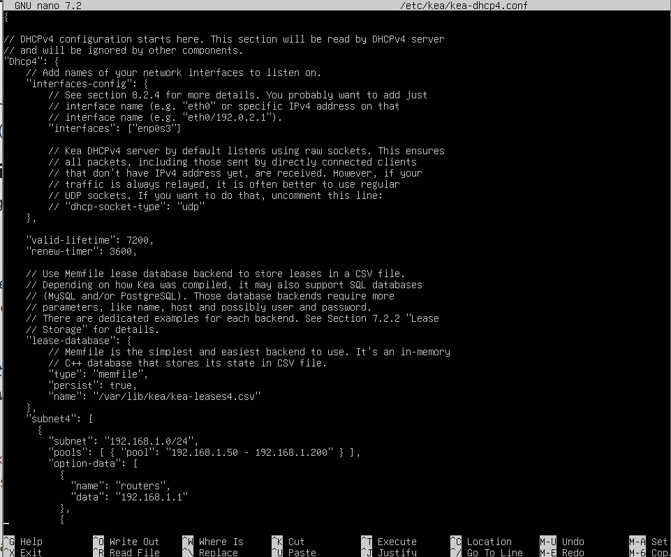
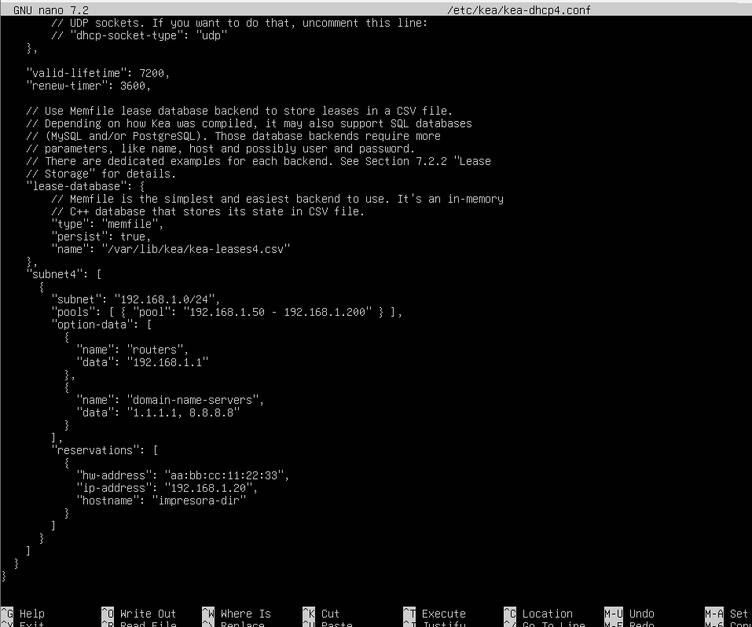
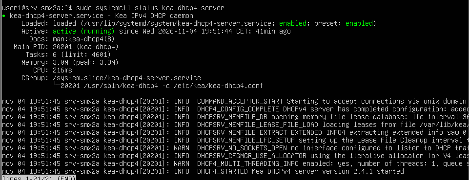
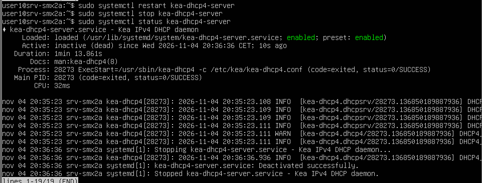
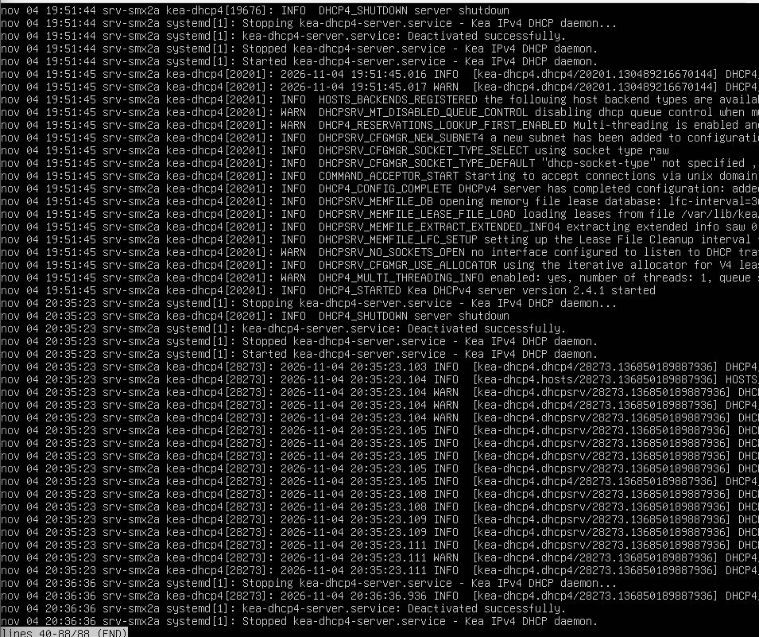
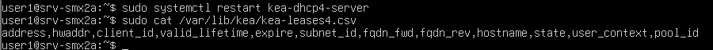
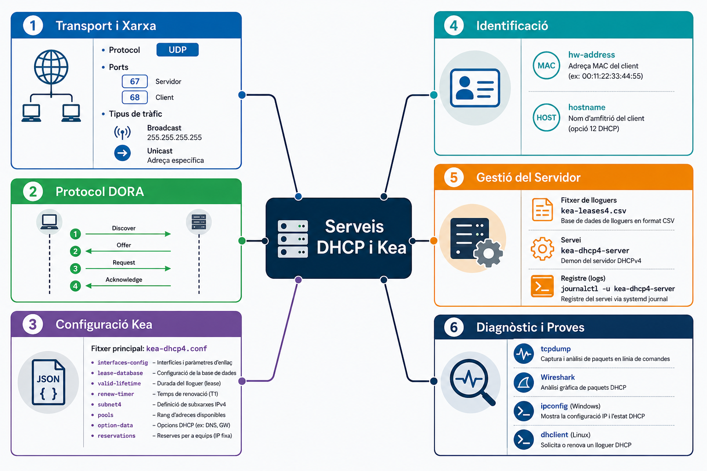

# AA2 – Avaluació: Anàlisi del servei Kea DHCP

**Mòdul:** M0227 – Serveis de Xarxa  
**Alumne:** Biel Clave  
**Curs:** SMX2  
**Empresa:** TechMataró SL  
**Data:** 04/11/2026

---

# 1. Introducció

En aquest projecte es posarà en pràctica la configuració d'un servidor DHCP4 utilitzant Kea en un sistema Linux.

Durant el desenvolupament de l'activitat s'aprendrà a distribuir adreces IP automàticament, establir configuracions de xarxa i assignar IP fixes a determinats dispositius mitjançant reserves MAC.

Les proves es realitzaran en una xarxa fictícia de l'empresa TechMataró SL, on serà necessari centralitzar la gestió de les connexions dels diferents equips.

---

# 2. Bloc 1 – Fonaments del protocol i anàlisi de tràfic

## 2.1 Funcionament de DHCP: procés DORA

Perquè un ordinador pugui connectar-se a una xarxa mitjançant DHCP, primer ha de completar quatre fases de comunicació:

1. **Discover:** el client envia una petició per trobar un servidor DHCP.
2. **Offer:** el servidor contesta oferint una adreça IP disponible.
3. **Request:** el client escull l'adreça proposada i en demana l'assignació.
4. **Acknowledge:** el servidor accepta la petició i confirma les dades de connexió.

### Diferència entre Broadcast i Unicast

Cal identificar quin tipus de comunicació es produeix durant cada etapa quan els equips es troben a la mateixa xarxa i no existeix DHCP Relay.

**Resposta:**

- **Discover:** Broadcast, ja que el client encara no sap on es troba el servidor.
- **Offer:** pot ser Broadcast o Unicast, segons les característiques de la comunicació.
- **Request:** Broadcast, perquè el client informa de quin servidor ha escollit.
- **Acknowledge:** pot ser Broadcast o Unicast, depenent de la situació del client.

## 2.2 Ports i informació de la capçalera DHCP

El protocol DHCP utilitza UDP per enviar i rebre les peticions entre els dispositius i el servidor.

Els ports utilitzats són:

- **UDP 67:** destinat al servidor DHCP.
- **UDP 68:** destinat al client DHCP.

### Identificació de la targeta de xarxa

**Pregunta:** Quin camp permet reconèixer la interfície física del dispositiu que realitza la petició?

**Resposta:** El camp `chaddr` identifica l'adreça física MAC del client. Aquesta informació permet al servidor saber quin dispositiu està sol·licitant una configuració de xarxa.

---

# 3. Bloc 2 – Configuració del servidor Kea DHCP

## 3.1 Interfície de xarxa i base de dades

El servidor s'ha de preparar per escoltar les peticions dels clients a través de la interfície de xarxa `eth0`.

Per gestionar les adreces que es van concedint, es farà servir el sistema d'emmagatzematge `memfile`, que permet guardar les concessions DHCP en un fitxer persistent.

## 3.2 Temps d'assignació de les adreces

Els temps de concessió s'han d'establir amb els valors següents:

| Paràmetre | Valor configurat |
|---|---|
| `valid-lifetime` | 7200 segons |
| `renew-timer` | 3600 segons |

## 3.3 Configuració de la xarxa i del rang DHCP

La xarxa interna de l'empresa utilitzarà el segment `192.168.1.0/24`.

El servidor haurà de distribuir les IP dins dels límits següents:

- **Adreça de xarxa:** `192.168.1.0/24`
- **IP inicial del pool:** `192.168.1.50`
- **IP final del pool:** `192.168.1.200`

D'aquesta manera, els dispositius podran obtenir una adreça automàticament quan es connectin.

## 3.4 Paràmetres que rebran els clients

A més de l'adreça IP, el servidor també proporcionarà les dades necessàries per configurar correctament la connexió.

| Paràmetre | Valor |
|---|---|
| Router | `192.168.1.1` |
| DNS principal | `1.1.1.1` |
| DNS secundari | `8.8.8.8` |
| Domini | `oficina.local` |

## 3.5 Configuració del fitxer `kea-dhcp4.conf`

Tots els paràmetres anteriors s'han d'introduir dins del fitxer de configuració del servidor Kea, utilitzant l'estructura JSON corresponent.

```json
{
  "Dhcp4": {
    // Configuració general del servidor
  }
}
```

### Evidència pràctica

A continuació s'adjunten les imatges del fitxer de configuració obert a l'editor.





---

# 4. Bloc 3 – Assignació estàtica i reserves MAC

## 4.1 Reserva d'una adreça IP

Per evitar que la impressora de l'empresa canviï d'adreça IP, es configurarà una reserva DHCP vinculada a la seva adreça MAC.

La informació que identificarà aquest dispositiu és:

| Paràmetre | Valor |
|---|---|
| `hw-address` | `aa:bb:cc:11:22:33` |
| Adreça IP reservada | `192.168.1.20` |
| `hostname` | `impresora-dir` |

Aquesta reserva s'haurà d'afegir dins de la configuració de la subxarxa, a l'apartat `reservations`.

```json
{
  // Dades de la reserva de la impressora
}
```

## 4.2 Verificació del fitxer de configuració

Abans d'engegar el servidor, és necessari comprovar que la configuració JSON estigui ben escrita i que Kea pugui interpretar-la.

Per fer-ho s'executarà aquesta comanda:

```bash
sudo kea-dhcp4 -t /etc/kea/kea-dhcp4.conf
```

**Resultat esperat:** si no hi ha cap problema, el programa indicarà que la configuració és vàlida. En cas contrari, mostrarà informació sobre els errors que s'han de corregir.

### Evidència pràctica

Captura de la terminal amb el resultat de la validació:


---

# 5. Bloc 4 – Comprovació, diagnòstic i resolució d'incidències

## 5.1 Control del servei DHCP

El servei Kea es pot administrar des de Linux mitjançant les ordres de `systemctl`.

| Acció | Comanda |
|---|---|
| Consultar l'estat actual | `sudo systemctl status kea-dhcp4-server` |
| Reiniciar el servidor | `sudo systemctl restart kea-dhcp4-server` |
| Parar el servei | `sudo systemctl stop kea-dhcp4-server` |
| Arrencar el servei | `sudo systemctl start kea-dhcp4-server` |

Aquestes ordres permeten comprovar si el servidor està actiu i gestionar-ne el funcionament.

## 5.2 Revisió dels registres

Quan es produeix una incidència, es poden consultar els missatges que genera el servei per localitzar-ne la causa.

La comanda utilitzada és:

```bash
sudo journalctl -u kea-dhcp4-server
```

**Ubicació:** els registres es gestionen a través del sistema `journal` de systemd i es consulten amb `journalctl`, sense necessitat d'un fitxer de text concret.

## 5.3 Fitxer on es guarden les concessions

Kea utilitza `memfile` per registrar les adreces IP que s'han assignat als clients.

Les dades es troben a:

```text
/var/lib/kea/kea-leases4.csv
```

El fitxer s'anomena `kea-leases4.csv` i conté la informació de les concessions DHCP.

## 5.4 Verificació des d'un ordinador Linux

Des del client Linux es poden fer proves per comprovar si el servidor distribueix correctament les adreces IP.

| Operació | Comanda |
|---|---|
| Alliberar la IP actual | `sudo dhclient -r eth0` |
| Tornar a demanar una IP | `sudo dhclient eth0` |
| Consultar l'adreça assignada | `ip addr show eth0` |

Aquestes comprovacions permeten verificar la comunicació entre el client i el servidor.

## 5.5 Verificació des d'un ordinador Windows

En Windows es poden utilitzar les eines de consola per renovar la configuració DHCP.

| Operació | Comanda |
|---|---|
| Alliberar l'adreça | `ipconfig /release` |
| Renovar l'adreça | `ipconfig /renew` |
| Consultar la configuració | `ipconfig /all` |

Amb aquestes ordres es poden revisar les dades de xarxa que ha rebut l'ordinador.

### Evidències pràctiques

A continuació es mostren les captures de les proves efectuades amb els diferents dispositius.









---

# 6. Bloc 5 – Mapa conceptual del servei DHCP

## 6.1 Representació dels elements principals

En aquest últim bloc es presenta un esquema visual amb els components més importants del protocol DHCP i del servidor Kea.

El mapa ha de relacionar els conceptes següents:

- **Transport:** UDP 67 i 68, Broadcast i Unicast.
- **Procés DORA:** Discover, Offer, Request i Acknowledge.
- **Configuració Kea:** `kea-dhcp4.conf`, `interfaces-config`, `lease-database`, `valid-lifetime`, `renew-timer`, `subnet4`, `pools`, `option-data` i `reservations`.
- **Identificació:** `hw-address` i `hostname`.
- **Administració:** `kea-leases4.csv`, `kea-dhcp4-server` i `journalctl`.
- **Diagnòstic:** `tcpdump`, Wireshark, `ipconfig` i `dhclient`.

L'esquema ha de mostrar les connexions entre aquests elements de manera clara i ordenada, utilitzant només els noms dels conceptes i les seves relacions.

### Mapa conceptual



---

# 7. Conclusió

### Què he après sobre Kea DHCP?

Durant aquesta activitat he après a configurar un servidor DHCP amb Kea, a repartir adreces IP automàticament i a establir reserves per a dispositius concrets. També he pogut entendre millor les diferents fases que segueix un client quan es connecta a una xarxa.

### Quina part m'ha resultat més difícil?

La part que m'ha portat més feina ha estat configurar correctament les adreces IP i escriure el fitxer JSON amb tots els paràmetres. Alguns errors de sintaxi i de configuració m'han obligat a revisar diverses vegades el treball.

### Quina funció té DHCP en una empresa?

Aquest servei facilita molt l'administració d'una xarxa empresarial, ja que permet assignar automàticament les dades de connexió als ordinadors i altres dispositius. D'aquesta manera, no cal configurar cada equip manualment i es poden gestionar les connexions des d'un únic servidor.
