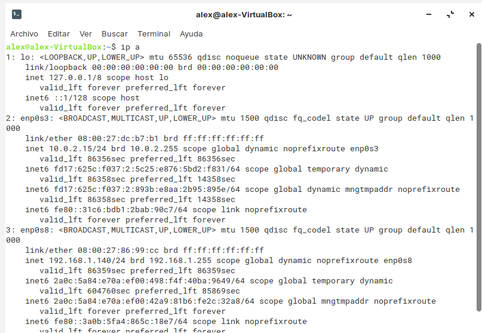
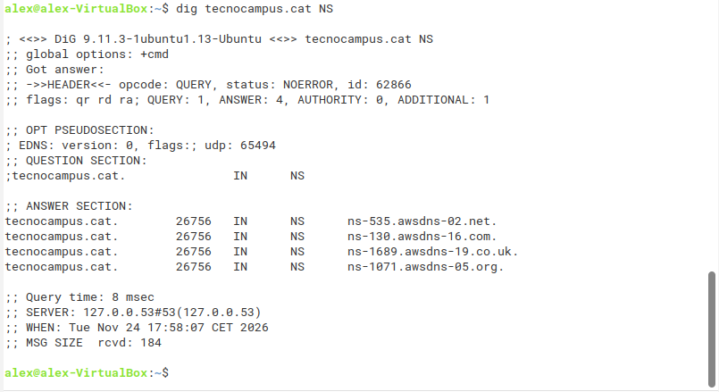
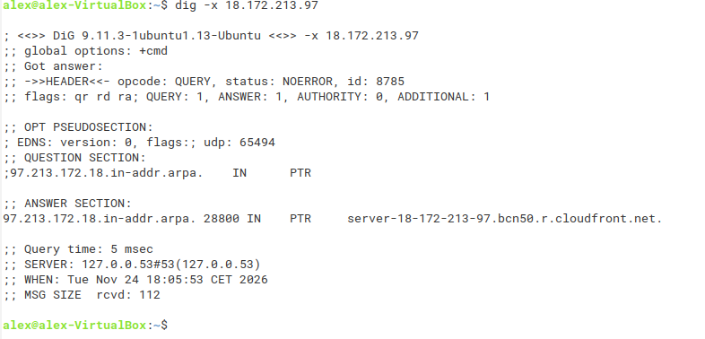
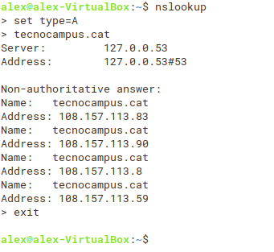

# Projecte de Consultoria DNS – TechCloud Solutions

**Mòdul:** Serveis de xarxa (CFGM SMX)
**Tema:** Protocol DNS: mapa conceptual i auditoria de resolució de noms (CLI)
**Client:** Innovació Tecnològica del Maresme S.L.
**Alumne/a:** `<Cognoms>`, Alex
**Data:** 24/11/2026

> **Nota d'ús d'aquest document:** els valors entre `<...>` (IPs, TTL, serial, etc.) s'han de substituir pels que doni la vostra màquina virtual en executar les comandes, i cal adjuntar-hi la captura real de cada pas.

---

## 1. Introducció

Aquest document recull el mapa conceptual sobre el funcionament del DNS i l'auditoria pràctica de resolució de noms amb `dig` i `nslookup` sobre el domini `tecnocampus.cat`, més una prova de resolució local amb **mDNS**.

---

## 2. Fase teòrica: mapa conceptual


| Concepte | Idea clau |
|---|---|
| **Concepte de DNS** | Sistema que tradueix noms de domini (`www.exemple.cat`) en adreces IP i viceversa. Objectius: facilitar l'accés als recursos amb noms recordables, desacoblar el nom de la IP i distribuir la gestió. |
| **Gestió de dominis** | Es contracta a un *registrador* (acreditat pel registre del TLD, p. ex. `.cat`): es comprova disponibilitat, es registren les dades del titular, es fixen els servidors de noms i es paga una renovació periòdica. |
| **Arquitectura DNS** | Clients (*resolvers/stub*), servidors recursius, servidors arrel, servidors de TLD i servidors autoritatius, més la memòria cau (*cache*). |
| **Estructura jeràrquica** | Arbre invertit: arrel (`.`) → TLD (`.cat`) → domini (`tecnocampus.cat`) → subdominis/hosts. |
| **Procés de resolució** | Consulta **recursiva** (el client demana la resposta final al servidor recursiu) vs. **iterativa** (el servidor recursiu va preguntant als Root, TLD i autoritatius, que només donen la referència següent). |
| **Tipus de zones** | **Directa** (nom → IP) i **inversa** (IP → nom, `in-addr.arpa`). **Primària** (conté l'original editable) i **secundària** (còpia per transferència de zona). |
| **Resolució local** | **mDNS** (Multicast DNS): resolució de noms `.local` sense servidor DNS centralitzat. |

---

## 3. Fase pràctica: auditoria de resolució de noms

### 3.1 Comprovació de la configuració de xarxa

Entorn: màquina virtual **Zorin OS** amb dues interfícies:

- `enp0s3` → mode **NAT** (sortida a Internet).
- `enp0s8` → mode **Adaptador pont (Bridged)** amb IP estàtica assignada pel responsable tècnic.

**Comanda:**

```bash
ip a
```



**Observació:** `enp0s3` rep la configuració per DHCP del NAT de VirtualBox i dona accés a Internet; `enp0s8` té una IP estàtica `<IP_ESTATICA_BRIDGED>` a la xarxa local, necessària per a les proves entre equips (mDNS).

---

### 3.2 Part A. Diagnosi avançada amb `dig`

#### Comanda 1: registre A

```bash
dig tecnocampus.cat A
```

**Anàlisi:**
- **IP de resposta:** `18.172.213.97` (adreça on resol el nom).
- **TTL:** `<TTL>` segons: temps durant el qual la resposta es pot guardar a la memòria cau abans de tornar a consultar.
- **Servidor DNS que ha respost:** `127.0.0.53` (línia `SERVER`), que és el *stub resolver* local de `systemd-resolved`. Aquest reenvia la consulta al DNS extern configurat a la xarxa NAT.

#### Comanda 2: registre NS

```bash
dig tecnocampus.cat NS
```



**Anàlisi:** els servidors de noms **autoritatius** del domini són quatre, i tots pertanyen a **Amazon Route 53** (`awsdns`):
- `ns-1071.awsdns-05.org.`
- `ns-1689.awsdns-19.co.uk.`
- `ns-130.awsdns-16.com.`
- `ns-535.awsdns-02.net.`

El TTL d'aquests registres NS és de `6434` segons en aquesta captura. Aquest valor va baixant a cada consulta perquè la resposta surt de la memòria cau del resolver local. Són els servidors que contenen la zona original i poden respondre amb autoritat. Estan repartits en quatre TLD diferents (`.org`, `.co.uk`, `.com` i `.net`) per donar redundància.

#### Comanda 3: registre SOA

```bash
dig tecnocampus.cat SOA
```


**Anàlisi:**
- **Correu de l'administrador (`rname`):** `awsdns-hostmaster.amazon.com.` Al registre SOA el primer punt substitueix la `@`, per tant equival a `awsdns-hostmaster@amazon.com` (el contacte d'administració d'Amazon Route 53, que allotja la zona).
- **Número de sèrie (`serial`):** `1`. En una zona DNS tradicional el serial indica la versió de la zona i els servidors secundaris el comparen amb el seu per decidir si cal una transferència de zona. A Route 53 el valor sol quedar-se a `1` perquè la sincronització entre els seus servidors es gestiona internament.

#### Comanda 4: resolució inversa

```bash
dig -x 18.172.213.97
```



**Anàlisi:** el registre **PTR** associa una IP a un nom dins la zona inversa (`in-addr.arpa`, amb els octets de la IP escrits al revés). La IP introduïda resol a: `<nom_de_domini_obtingut>`. Pot no coincidir amb `tecnocampus.cat`, ja que la zona inversa la gestiona normalment el propietari del bloc d'IPs (el proveïdor o hosting) i no el titular del domini. Si no hi ha registre PTR, cal indicar-ho així.

---

### 3.3 Part B. Comprovació amb `nslookup` (mode interactiu)

#### Comanda 5: consulta no autoritativa

```bash
nslookup
```

Dins del prompt `>`:

```text
set type=A
tecnocampus.cat
exit
```



**Anàlisi:** la resposta és **no autoritativa** (*Non-authoritative answer*) perquè no prové d'un servidor que tingui la zona `tecnocampus.cat` com a pròpia, sinó d'un servidor recursiu que l'ha obtinguda d'un altre servidor o de la seva **memòria cau**.

#### Comanda 6: consulta autoritativa directa

```bash
nslookup
```

Dins del prompt `>`:

```text
server ns-1071.awsdns-05.org
set type=A
tecnocampus.cat
exit
```

**Anàlisi:** en consultar directament un servidor autoritatiu, **desapareix** la línia `Non-authoritative answer` (confirmar-ho a la captura). La IP ha de coincidir amb la de la Comanda 5 (`18.172.213.97`), amb la diferència que aquesta resposta ve de la font original de la zona i no d'una memòria cau.

---

### 3.4 Part C. Resolució local i protocol mDNS

#### Nom d'host de la màquina Zorin OS

```bash
hostname
```


Nom d'host obtingut: `alex-VirtualBox`

#### Prova de ping des d'un altre equip

```bash
ping alex-VirtualBox.local
```


Si no respon, cal comprovar que `avahi-daemon` està actiu a Zorin OS i que ambdós equips són a la mateixa xarxa bridged.

**Anàlisi del protocol mDNS (Multicast DNS):**
- Permet resoldre noms de la xarxa local (domini `.local`) **sense cap servidor DNS** dedicat.
- Cada equip escolta consultes enviades per **multicast** (IPv4 `224.0.0.251`) i respon si el nom demanat és el seu.
- Utilitza el port **UDP 5353**.
- **Avantatge:** configuració zero. Equips, impressores o dispositius es troben pel nom en xarxes petites sense administrar zones ni registres DNS. En Linux sol implementar-lo `avahi-daemon`.

---

## 4. Conclusions finals

- El DNS és un sistema **jeràrquic i distribuït** que depèn de servidors arrel, TLD i autoritatius, amb memòria cau per millorar el rendiment.
- `dig` i `nslookup` permeten diferenciar respostes **autoritatives** i **no autoritatives**, i revisar registres A, NS, SOA i PTR, útil per diagnosticar la lentitud i incidents del client.
- El **TTL** i el **serial del SOA** són claus per entendre la propagació i el cacheig dels canvis.
- **mDNS** resol noms en xarxa local sense servidor central, i complementa el DNS tradicional.

---

## 5. Fonts i eines consultades

- Documentació `man dig`, `man nslookup` i `man avahi-daemon`.
- RFC 1034 i 1035 (DNS) i RFC 6762 (Multicast DNS).
- **Declaració d'ús d'IA generativa:** s'ha utilitzat Claude (Anthropic) com a ajuda per estructurar aquest document `guia.md` i Gemini (Google) per generar el mapa conceptual. Les execucions, captures i comprovacions a la màquina virtual són de l'alumne.
